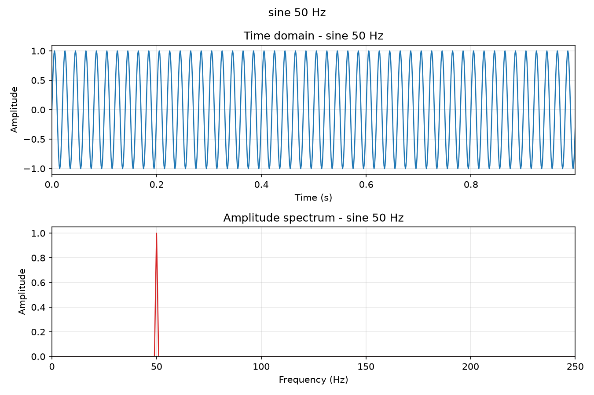
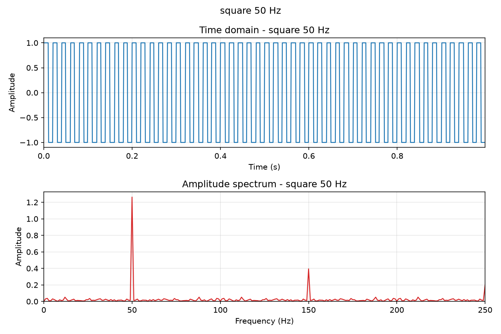
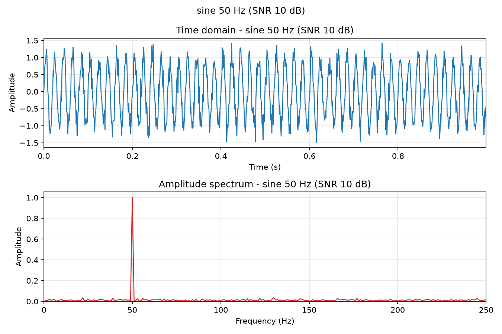

# signallab

[](https://github.com/Nava123799/myproject/actions/workflows/ci.yml)
[](https://www.python.org/)
[](LICENSE)
[](https://github.com/astral-sh/ruff)

> 生成测试信号，做时域与频域分析，一条命令出图。

`signallab` 是一个用纯 `numpy` + `matplotlib` 实现的数字信号分析小工具：给定波形类型、频率和采样率，生成离散信号，再用 FFT 求出频谱，输出可直接放进报告的双面板图。



## 为什么做这个

课程里的频谱分析大多停留在公式推导。但公式和「屏幕上长什么样」之间差着一次实现——采样率选错会混叠、频率不落在频点上会泄漏、幅度归一化少乘个 2 就差一倍。

这个项目把这条链路完整跑通，并且用测试把每个容易出错的地方钉死：幅度归一化有断言、频点对齐有断言、信噪比有断言。**每个数字都能被验证，不是画出来好看就算**。

## 特性

- **三种波形**：正弦、方波、线性调频（chirp），支持叠加高斯白噪声并指定 SNR
- **频谱分析**：单边幅度谱（正确归一化，DC 与 Nyquist bin 分别处理）、峰值频率、峰值幅度、带内功率（Parseval）
- **一键出图**：时域 + 频谱双面板，`--out` 直接存 PNG，headless 环境（SSH / CI）可用
- **可测量**：`--snr 20` 加噪后峰值频率依然能准确检出，这一点由测试保证
- **工程化**：pytest 覆盖关键路径、Ruff 静态检查、GitHub Actions 四版本矩阵 CI

## 安装

```bash
git clone git@github.com:Nava123799/myproject.git
cd myproject
python -m venv .venv
source .venv/bin/activate      # Windows: .venv\Scripts\activate
pip install -e ".[dev]"
```

## 用法

### 命令行

```bash
$ signallab --type sine --freq 50 --fs 1000 --duration 1
signal      : sine 50 Hz
samples     : 1000
sample rate : 1000 Hz
duration    : 1 s
peak freq   : 50.0 Hz
peak ampl.  : 1.000
```

加噪声并出图：

```bash
signallab --type sine --freq 50 --snr 20 --out docs/images/sine_noisy.png
```

线性调频（20 Hz 扫到 200 Hz）：

```bash
signallab --type chirp --freq 20 --freq-end 200 --out docs/images/chirp.png
```

| 方波 50 Hz | 含噪正弦（SNR 10 dB） |
|---|---|
|  |  |

方波那幅图能直接看出谐波：基波在 50 Hz，奇次谐波 150 / 250 / 350 Hz 依次衰减。含噪那幅则说明了为什么「时域看不出来、频域一眼就清楚」——噪声摊平在整个频带上，信号峰依然干净。

### 作为库调用

```python
from signallab import dominant_frequency, sine, with_white_noise
from signallab.plotting import save_overview

signal = sine(freq=50.0, fs=1000.0, duration=1.0, amplitude=2.0)
noisy = with_white_noise(signal, snr_db=10.0)

dominant_frequency(noisy, min_freq=1.0)  # 50.0
save_overview(noisy, "docs/images/demo.png")
```

也可以不安装直接跑：`python -m signallab --freq 50`

## 实现要点

几个容易写错、这里特意处理过的地方：

1. **采样点数是 `round(fs * duration)`，不是 `arange(0, duration, 1/fs)`**。后者用浮点步长会累积误差，导致 FFT 频点偏移，本应落在 bin 中心的频率落进两个 bin 之间，频谱出现虚假的泄漏。
2. **幅度归一化 `2/N`，且 DC 与 Nyquist bin 要单独除以 2**。这两个 bin 没有镜像分量可以折叠回来，不单独处理的话幅度会翻倍。
3. **chirp 的相位是瞬时频率的积分**。直接写 `sin(2π f(t) · t)` 是错的——那得到的不是线性扫频，这个坑在教科书习题里经常出现。
4. **加噪按实测功率反推噪声功率**，所以任意幅度下设定的 SNR 都成立，并且默认固定随机种子，保证 README 里的图可复现。
5. **绘图后端强制 `Agg`**，CI 与 SSH 无显示环境下也能保存图片；本地想看交互窗口改 `plotting.py` 一行即可。

## 项目结构

```
.
├── .github/workflows/ci.yml     # 3.10–3.13 矩阵：ruff + format + pytest --cov
├── src/signallab/
│   ├── signals.py               # 信号生成与 Signal 数据类（校验 + 时间轴）
│   ├── spectrum.py              # FFT、幅度归一化、峰值检测、带内功率
│   ├── plotting.py              # 时域/频域绘图，Agg 后端
│   ├── cli.py                   # argparse 命令行
│   └── py.typed                 # PEP 561
├── tests/                       # 用例与 src 一一对应
└── docs/images/                 # README 示例图（由本工具自己生成）
```

## 开发

```bash
pytest --cov                    # 测试 + 覆盖率
ruff check .                    # 静态检查
ruff format .                   # 格式化
```

## 路线图

后续按「一个功能对应一个知识点」推进，保证每一步都能讲清原理：

| 版本 | 内容 | 对应知识点 | 状态 |
|---|---|---|---|
| v0.2 | 信号生成、FFT 频谱、峰值检测、绘图 | 采样定理、DFT | ✅ 已完成 |
| v0.3 | 加窗（Hann/Hamming）与频谱泄漏定量对比 | 频谱泄漏、窗函数 | 计划中 |
| v0.4 | 采样率过低导致混叠的复现与验证 | 奈奎斯特准则 | 计划中 |
| v0.5 | FIR 低通滤波器设计（窗函数法）与去噪实验 | FIR 设计、卷积 | 计划中 |
| v0.6 | IIR 滤波器与相位延迟对比 | IIR、群延迟 | 计划中 |
| v0.7 | 交互式可视化界面 | — | 待定 |

## 许可证

[MIT](LICENSE) © 2026 Gong Zhuoer
